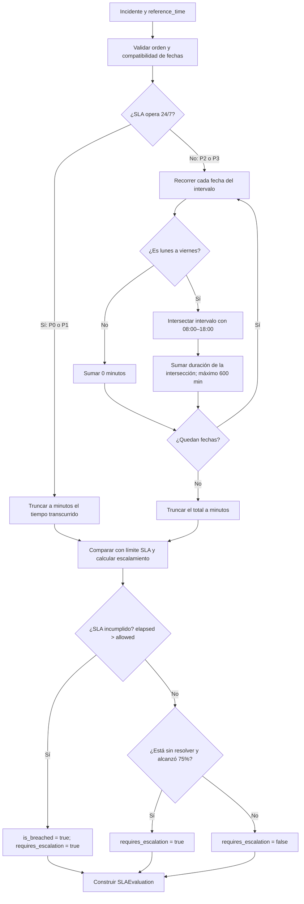

# ADR-002: Cálculo de SLA en horario hábil y escalamiento preventivo

- **Estado**: Aceptado
- **Fecha**: 2026-11-15
- **Autor(es)**: Equipo IncidentOps
- **Componentes Afectados**: [`src/sla_calculator.py`], [`src/models.py`]

---

## 1. Contexto y Problema

`evaluate_sla_status` calcula actualmente el tiempo transcurrido como la diferencia total entre la creación del incidente y `resolved_at` o `reference_time`. Ese cálculo es correcto para los SLA que operan 24/7, pero cuenta noches y fines de semana para P2 y P3, aunque estos niveles solo disponen de horario hábil.

El cálculo debe conservar la política existente de severidad (`SLA_POLICY_TABLE`): P0 permite 60 minutos y opera 24/7; P1 permite 240 minutos y opera 24/7; P2 permite 480 minutos; y P3 permite 1440 minutos. Para P2 y P3, el tiempo válido se limita a lunes a viernes, de 08:00 a 18:00, con un máximo de 600 minutos por jornada.

El resultado actual también activa el escalamiento preventivo únicamente mientras el incidente no esté resuelto y el SLA no se haya incumplido. La decisión debe mantener el escalamiento cuando se alcanza el umbral del 75% y dejarlo activo si el SLA ya fue incumplido, incluso si el incidente posteriormente figura como resuelto.

La solución debe ser determinista, preservar la estructura de `SLAEvaluation` y `Incident`, validar fechas y compatibilidad de zonas horarias, y evitar dependencias externas. El cálculo de horario hábil debe recorrer los días comprendidos en el intervalo, con complejidad temporal O(D), donde D es el número de días del intervalo.

## 2. Opciones Consideradas

1. **Opción A — Iterar por día e intersectar intervalos laborales (seleccionada)**:
   - *Ventajas*: Aplica directamente el horario de lunes a viernes; permite tratar de forma clara los límites diarios, los fines de semana y los intervalos de varias semanas; no requiere dependencias externas; su complejidad es O(D).
   - *Desventajas*: El costo crece con la cantidad de días del intervalo, incluso cuando muchos días completos podrían contabilizarse mediante una fórmula.
2. **Opción B — Cálculo aritmético por semanas completas y días restantes**:
   - *Ventajas*: Puede reducir el trabajo para intervalos de muchos años al saltar semanas completas.
   - *Desventajas*: Aumenta la complejidad de los cálculos de límites, semanas parciales y días inicial y final; resulta menos legible para el rango esperado y no aporta una mejora necesaria para esta decisión.
3. **Opción C — Biblioteca externa de calendarios o fechas laborales**:
   - *Ventajas*: Una biblioteca especializada puede ofrecer calendarios y operaciones de fechas adicionales.
   - *Desventajas*: Añade dependencias y configuración innecesarias para un horario fijo que solo excluye fines de semana; los festivos no tienen una política ni un calendario definidos en el alcance actual.

## 3. Decisión Arquitectónica

Se elige la **Opción A**. Para P0 y P1, se conserva el cálculo continuo de tiempo transcurrido. Para P2 y P3, se recorre cada fecha entre la creación y el fin de evaluación. En cada día laborable se intersecta el intervalo del incidente con la jornada `[08:00, 18:00]` y se acumulan los minutos de esa intersección. Sábados y domingos aportan cero minutos. El total de segundos contabilizados se trunca a minutos enteros, como en el comportamiento existente.

Las fechas de creación y evaluación deben estar ordenadas y tener marcas temporales comparables: ambas ingenuas (sin zona horaria) o ambas conscientes (con zona horaria). Una mezcla incompatible se rechaza como entrada inválida. Para incidentes con marcas conscientes se usa la misma base horaria de las marcas recibidas, sin conversión implícita. La definición de una zona horaria de negocio común queda fuera de esta decisión y debe establecerse si el sistema recibe incidentes de distintas zonas.

Para el cálculo de horario hábil, una creación anterior a las 08:00 empieza a contar a las 08:00 de ese día si es laborable. Una creación posterior a las 18:00 no aporta tiempo ese día; el conteo empieza en la siguiente jornada laborable. Una evaluación antes de las 08:00 no añade tiempo de ese día; después de las 18:00, el día aporta como máximo los 600 minutos de jornada. En fines de semana no se cuenta tiempo. Estas reglas se aplican a intervalos que cubren varios días o semanas mediante la misma iteración diaria.

No se aplica un calendario de festivos: con la información disponible, los días de lunes a viernes se consideran laborables, aunque sean festivos. Excluir festivos requeriría una política y una fuente de calendario adicionales.

El escalamiento se calcula usando el límite entero `int(max_resolution_minutes * escalation_threshold_ratio)`. Para un incidente no resuelto, se activa al alcanzar o superar ese límite, siempre que el SLA aún no esté incumplido. El incumplimiento conserva la comparación existente (`elapsed_minutes > allowed_minutes`); cuando `is_breached` es verdadero, `requires_escalation` también es verdadero, incluso para un incidente resuelto. Un incidente resuelto que no incumplió el SLA no requiere escalamiento preventivo.

## 4. Consecuencias e Impacto

- **Positivas**: P0 y P1 mantienen su conteo continuo; P2 y P3 dejan de consumir SLA fuera del horario definido; los límites de jornada, fines de semana y varios días se manejan mediante una regla uniforme; el escalamiento se activa en el umbral y persiste tras el incumplimiento. No se agregan dependencias ni campos al modelo de resultado.
- **Negativas / Trade-offs**: El cálculo hábil cuesta O(D) en el número de días del intervalo. Los festivos entre semana cuentan como días laborables. El algoritmo usa la base horaria de las marcas temporales recibidas y no convierte entre zonas; por ello, la consistencia de esa base depende de los datos de entrada.
- **Riesgos**: Una gran antigüedad del incidente aumenta el número de iteraciones. La ausencia de una zona horaria de negocio definida puede causar diferencias en los límites de jornada si las marcas provienen de zonas distintas. La política de festivos podría requerir una decisión posterior si los acuerdos de servicio los excluyen.
- **Verificación**: Comprobar los cuatro niveles contra sus límites y modo de operación; verificar creación antes de las 08:00, durante la jornada y después de las 18:00; evaluar antes, durante y después del horario; probar sábado y domingo, cruces de semana y varias semanas; confirmar truncamiento de minutos, rechazo de evaluación anterior a la creación y rechazo de fechas con zonas incompatibles; validar el escalamiento justo antes y al alcanzar el 75%, después del incumplimiento y para incidentes resueltos con y sin incumplimiento.
