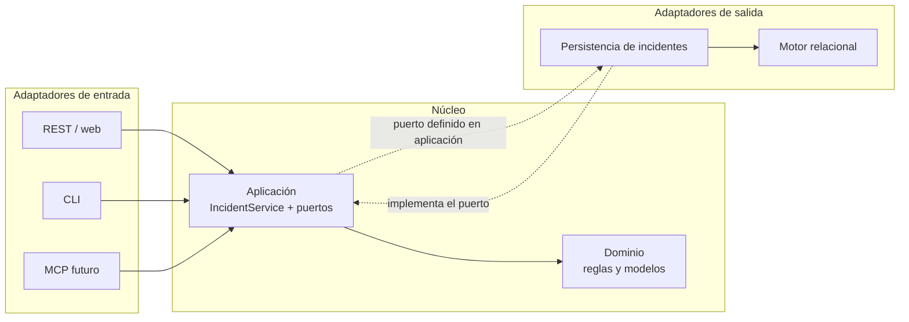

# ADR-003: Adopción de Arquitectura Hexagonal para IncidentOps
- **Estado**: Aceptado
- **Fecha**: 2026-11-23
- **Autor(es)**: [Nombre del Ingeniero / Equipo]
- **Reemplaza a**: *(Opcional: `ADR-XXX`, parcial o totalmente)*
---
## 1. Contexto y Problema

IncidentOps evolucionará de módulos Python planos hacia un servicio consumible desde varias interfaces y con persistencia relacional intercambiable, según los hitos H001–H004 del roadmap. Hoy la clasificación y las políticas de SLA están en módulos independientes, mientras que el acceso a incidentes mezcla consulta, SQLite y evaluación de SLA en `IncidentRepository`.

La decisión es cómo estructurar el núcleo para que las interfaces y la persistencia puedan evolucionar sin acoplar las reglas de negocio a un framework web o a un motor de base de datos. Se busca preservar el uso desde terminal, habilitar interfaces web y una futura integración MCP, y mantener abierta la sustitución del motor de persistencia.
---
## 2. Opciones Consideradas

1. **Opción A — Arquitectura en capas acoplada a FastAPI y SQLite**:
- *Ventajas*: Organización familiar y directa; poca estructura inicial y acceso sencillo a capacidades específicas del framework y la base de datos.
- *Desventajas*: La lógica de aplicación y dominio puede depender de FastAPI o SQLite; otras interfaces y motores aumentan el acoplamiento y el costo de cambio.
2. **Opción B — Arquitectura Hexagonal con puertos y adaptadores**:
- *Ventajas*: Separa el dominio y los casos de uso de las interfaces y la persistencia; permite incorporar adaptadores REST, CLI y MCP, así como cambiar motores de base de datos con menor impacto en el núcleo.
- *Desventajas*: Requiere definir y mantener límites y puertos explícitos; añade estructura y abstracciones frente a una aplicación pequeña.
---
## 3. Decisión Arquitectónica

Se adopta la **Opción B**. El dominio reside en `src/domain/`; los casos de uso y puertos, incluidos los definidos mediante `typing.Protocol`, en `src/application/`. `IncidentService` coordina los casos de uso. Los adaptadores de entrada viven en `src/adapters/inbound/` y los de salida en `src/adapters/outbound/`.

Los adaptadores de entrada invocarán la aplicación. La aplicación dependerá de abstracciones, no de adaptadores concretos; los adaptadores de salida implementarán los puertos requeridos. El ensamblaje del servicio conectará esas piezas. REST, CLI, una futura interfaz MCP y distintos motores de base de datos son adaptadores posibles, no decisiones sobre contratos o tecnologías específicas.

---
## 4. Consecuencias y Trade-offs
- **Positivas**: El dominio no depende de interfaces, frameworks ni motores de base de datos; las interfaces y la persistencia pueden variar a través de adaptadores; los casos de uso tienen fronteras explícitas.
- **Negativas / Trade-offs**: Se asume el costo de definir puertos, inyección de dependencias y ensamblaje; para una aplicación pequeña puede resultar más estructura de la necesaria, y los límites requieren disciplina para no filtrar detalles de adaptadores al núcleo.
