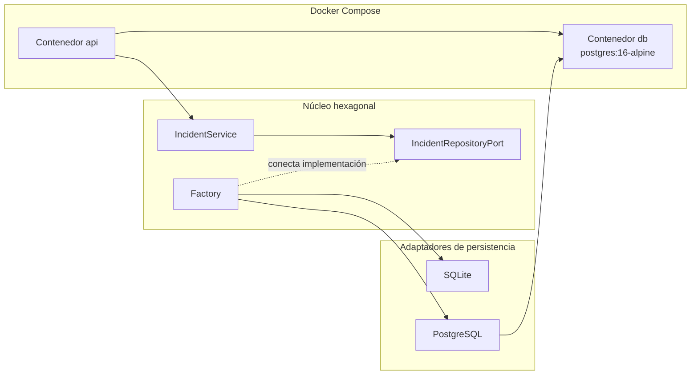

# ADR-004: Persistencia PostgreSQL y runtime en contenedores
- **Estado**: Aceptado
- **Fecha**: 2026-11-24
- **Autor(es)**: Equipo IncidentOps
- **Reemplaza a**: ADR-001 (parcialmente)
---
## 1. Contexto y Problema

El despliegue de producción requiere una base relacional dedicada, ejecución
contenedorizada y un runtime capaz de comprobar la conectividad real con la
persistencia. La solución debe conservar los límites hexagonales de IncidentOps,
el puerto `IncidentRepositoryPort` y el SQL explícito sin ORM, a la vez que permita
desarrollo y pruebas locales rápidas sin un servicio de base de datos externo.

La restricción previa de persistencia basada exclusivamente en `sqlite3` sin
dependencias externas deja de ser suficiente para producción. La decisión es
añadir PostgreSQL como adaptador de persistencia y establecer una topología
multi-contenedor sin acoplar el núcleo de dominio o aplicación a un motor.
---
## 2. Opciones Consideradas

1. **Opción A — Persistencia dual SQLite/PostgreSQL sin ORM y Docker Compose**:
- *Ventajas*: Mantiene SQLite en memoria para desarrollo y pruebas rápidas sin
  daemon externo; conserva control directo sobre consultas y transacciones SQL;
  permite usar PostgreSQL dedicado en producción y conectar los contenedores `api`
  y `db` mediante Docker Compose.
- *Desventajas*: Requiere mantener dos adaptadores SQL y verificar su paridad. Los
  timestamps deben almacenarse en formato ISO 8601 normalizado a UTC como `TEXT`
  para que ambos motores comparen y ordenen los instantes de forma determinista.
  Añade la dependencia de driver `psycopg[binary]` al adaptador PostgreSQL.
2. **Opción B — ORM unificado sobre SQLite y PostgreSQL**:
- *Ventajas*: Un modelo de persistencia y una abstracción de dialecto pueden reducir
  diferencias entre motores; ofrece utilidades integradas para mapeo y composición
  de consultas.
- *Desventajas*: Introduce una dependencia de ORM y acoplamiento adicional en la
  persistencia, puede ocultar SQL, transacciones y diferencias de rendimiento, y
  exige mapear explícitamente las entidades del dominio a modelos persistentes.
3. **Opción C — PostgreSQL exclusivo, eliminando SQLite**:
- *Ventajas*: Un único motor, adaptador y dialecto SQL en todos los entornos;
  elimina la necesidad de mantener compatibilidad entre implementaciones.
- *Desventajas*: Las pruebas unitarias y el desarrollo local requieren levantar y
  mantener un servicio PostgreSQL; el ciclo TDD pierde la sencillez y velocidad
  que ofrece SQLite en memoria.
---
## 3. Decisión Arquitectónica

Se adopta la **Opción A**. `DATABASE_URL` selecciona el adaptador en la frontera
de composición: `sqlite:///:memory:` por defecto para desarrollo y pruebas, y
`postgresql://...` para producción. El adaptador PostgreSQL utilizará
`psycopg[binary]` y SQL explícito, sin ORM. Ambos adaptadores persistirán fechas
ISO 8601 normalizadas a UTC como `TEXT`, manteniendo una representación temporal
canónica e independiente del tipo de timestamp nativo de cada motor.

En producción, Docker Compose define dos contenedores: `api` para el servicio y
`db` basado en `postgres:16-alpine`. La topología conserva el núcleo hexagonal:
`IncidentService` depende de `IncidentRepositoryPort`; la factory selecciona el
adaptador SQLite o PostgreSQL. El chequeo de salud del servicio comprobará la
conectividad real con el repositorio seleccionado.

---
## 4. Consecuencias y Trade-offs
- **Positivas**: Producción obtiene persistencia relacional dedicada y runtime
  contenedorizado; desarrollo conserva ejecución en memoria sin daemon; los motores
  siguen reemplazables detrás del mismo puerto; el SQL explícito y la arquitectura
  hexagonal permanecen intactos; la representación UTC común facilita resultados
  temporales consistentes entre adaptadores.
- **Negativas / Trade-offs**: Se mantiene y prueba la paridad de dos adaptadores
  SQL; se incorpora `psycopg[binary]` y configuración de contenedores; almacenar
  tiempos como texto traslada la consistencia de ordenamiento al formato ISO 8601
  UTC canónico, en lugar de delegarla a tipos temporales nativos de cada motor.
